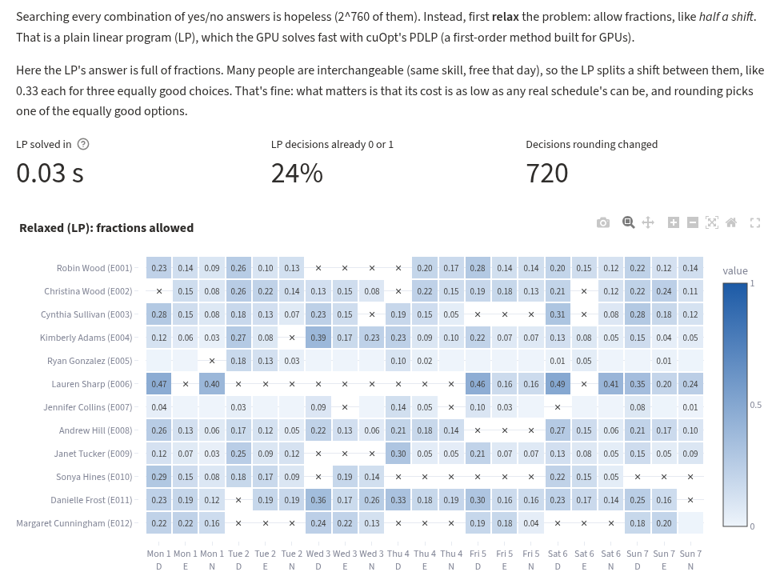
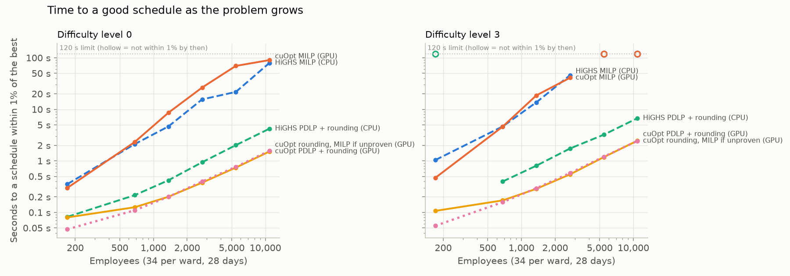
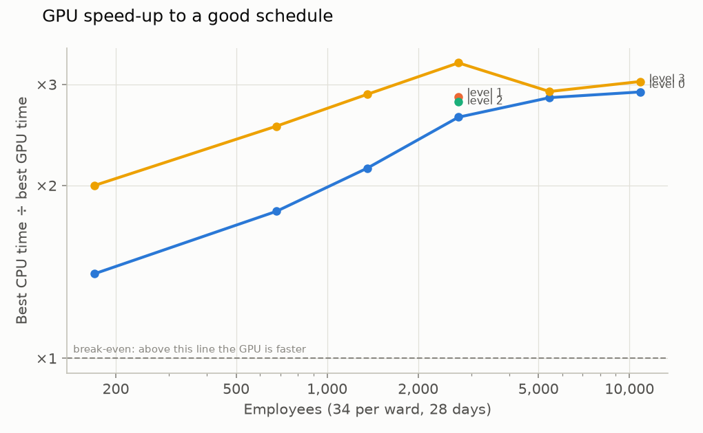

# ⚡ NVIDIA cuOpt Scheduler

A high-performance, GPU-accelerated staff scheduling application powered by **NVIDIA cuOpt** and **Streamlit**.

This project solves a nurse rostering problem as a mixed-integer program, on a local NVIDIA GPU with cuOpt or on the CPU with HiGHS, and includes a benchmark to compare the two honestly (see [GPU vs CPU](#-gpu-vs-cpu)).


## 🚀 Features

* **GPU or CPU:** Solves with NVIDIA cuOpt, with automatic fallback to HiGHS on CPU, and can solve the same problem on both side by side.
* **Realistic Simulation:** Generates "fake" but realistic employee profiles (names, skills, availability) using `Faker`.
* **Interactive Visualization:**

    * **Gantt Charts:** Visual timeline of staff assignments.

    * **Heatmaps:** Instant analysis of shift coverage and gaps.

* **How it was solved:** A teaching tab that walks through the MILP for the problem you just solved: the yes/no decisions as a grid, each rule and how many constraints it creates, the cost broken into its parts, the LP relaxation next to its rounded schedule, and the lower bound that proves no schedule is cheaper (or the gap the solver's search had to close).
* **Constraint Handling:** Skill requirements, weekly hour caps, availability, one shift per day and a minimum rest between shifts (default 11h).
* **Never just "Infeasible":** When there aren't enough staff, the app still produces the best schedule and lists exactly which shifts are short.
* **Export:** Download optimized schedules as CSV files.



## 🛠️ Prerequisites

* **Python:** 3.11+ and [uv](https://docs.astral.sh/uv/).
* **For the GPU solver (optional):** Linux or WSL2, an NVIDIA GPU (RTX 30/40-series recommended) and drivers supporting CUDA 13. Without one the app runs on the CPU solver (HiGHS).

## 📦 Installation

```bash
git clone <this repo> && cd cuopt-scheduler
uv sync --extra gpu   # with NVIDIA cuOpt
uv sync               # CPU only
```

The NVIDIA package index is configured in `pyproject.toml`, and `uv.lock` pins every version.

## 🖥️ Usage

```bash
uv run streamlit run app.py
```

* Open `http://localhost:8501`.
* In the **Sidebar**, set the number of wards, employees, schedule length and a random seed (same seed, same data). About 45 employees per ward cover all demand.
* Adjust the minimum rest, time limit and an optional optimality gap.
* Toggle **"Use NVIDIA GPU"**, or tick **compare** to solve on both. Both are disabled when cuOpt is not available.
* Click **Generate & Solve**.

## 📈 GPU vs CPU

```bash
uv run cuopt-bench --wards 5 20 80 --levels 0 3 --days 28 --time-limit 120 --csv results.csv
uv run cuopt-plots results.csv --out docs/img   # the charts below
uv run cuopt-bench --help
```

Every method gets the identical model arrays, and every schedule is checked by the independent validator. The question is how long a planner waits for a **good roster**: the benchmark reports when each method first had a schedule within 1% of the best any method found (`near_seconds`), as well as total time (which for the MILP solvers includes proving optimality).

Six methods, with cuOpt 26.10.1 and HiGHS 1.16 on an RTX 4080 Laptop GPU and an i9-13980HX (24 cores):

| Method | Device | What it does |
|---|---|---|
| `highs-mip` | CPU | HiGHS branch-and-bound, proves optimality |
| `cuopt-mip` | GPU | cuOpt's MILP solver from scratch (tuned: presolve off, PDLP root LP) |
| `cuopt-pdlp+round+mip` | GPU | **cuOpt PDLP + rounding, proven optimal by the LP bound; cuOpt's MILP solver, started from that schedule, runs only if the bound doesn't prove it.** What the app uses. |
| `cuopt-pdlp+round` | GPU | cuOpt PDLP (Stable2 mode) on the LP relaxation, then greedy rounding |
| `highs-pdlp+round` | CPU | the same with HiGHS's CPU PDLP |
| `highs-simplex+round` | CPU | the same with HiGHS's dual simplex |

LP + rounding works so well here because this model's LP bound equals the best schedule's cost, and rounding can never break a rule (`lp_round.py` explains why). It also proves optimality: the LP solver's duals give a guaranteed lower bound on the cost of any schedule (a Lagrangian bound, valid even for PDLP's approximate duals; see `ScheduleModel.lower_bound`). Costs are whole numbers, so a rounded schedule less than 1 above that bound is optimal. Every LP + rounding method uses this proof; only `cuopt-pdlp+round+mip` falls back to a MILP solver when it fails.

### Results

28 days, 34 staff per ward (deliberately tight), seed 0, 120 s limit. Difficulty levels add rules: 1 = at most 5 days in a row, 2 = also at most 2 night shifts a week, 3 = also disliked shifts (about 20%, each costing extra).

<picture>
  <source media="(prefers-color-scheme: dark)" srcset="docs/img/time-to-good-dark.png">
  
</picture>

<picture>
  <source media="(prefers-color-scheme: dark)" srcset="docs/img/speedup-dark.png">
  
</picture>

<picture>
  <source media="(prefers-color-scheme: dark)" srcset="docs/img/levels-dark.png">
  
</picture>

Seconds to a schedule within 1% of the best (– = not within 1% by the 120 s limit; **bold** = fastest):

| Employees | Level | HiGHS MILP (CPU) | cuOpt MILP (GPU) | cuOpt rounding, MILP if unproven (GPU) | HiGHS simplex + rounding (CPU) | HiGHS PDLP + rounding (CPU) | cuOpt PDLP + rounding (GPU) |
|---|---|---|---|---|---|---|---|
| 170 | 0 | 0.35 | 0.3 | **0.047** | 0.14 | 0.082 | 0.08 |
| 170 | 3 | 1 | 0.47 | **0.055** | 0.18 | – | 0.11 |
| 680 | 0 | 2.1 | 2.3 | **0.11** | 0.33 | 0.22 | 0.13 |
| 680 | 3 | 4.7 | 4.6 | **0.16** | 0.78 | 0.4 | 0.17 |
| 1,360 | 0 | 4.7 | 8.6 | **0.2** | 0.77 | 0.42 | **0.2** |
| 1,360 | 3 | 14 | 19 | **0.29** | 2.8 | 0.81 | **0.29** |
| 2,720 | 0 | 16 | 26 | 0.4 | 2.8 | 0.94 | **0.38** |
| 2,720 | 1 | 36 | 66 | **0.56** | 14 | 1.4 | **0.54** |
| 2,720 | 2 | 45 | 63 | **0.59** | 18 | 1.5 | **0.57** |
| 2,720 | 3 | 46 | 41 | 0.58 | 21 | 1.7 | **0.55** |
| 5,440 | 0 | 22 | 69 | **0.77** | 10 | 2 | **0.74** |
| 5,440 | 3 | – | – | **1.2** | – | 3.2 | **1.2** |
| 10,880 | 0 | 80 | 90 | **1.6** | 57 | 4.2 | **1.5** |
| 10,880 | 3 | – | failed (GPU memory) | **2.4** | – | 6.7 | **2.5** |

Seconds to a **proven** optimal schedule (– = not proven by the 120 s limit):

| Employees | Level | HiGHS MILP (CPU) | cuOpt MILP (GPU) | cuOpt rounding, MILP if unproven (GPU) | HiGHS simplex + rounding (CPU) | HiGHS PDLP + rounding (CPU) | cuOpt PDLP + rounding (GPU) |
|---|---|---|---|---|---|---|---|
| 170 | 0 | 0.36 | 1.5 | **0.047** | 0.14 | 0.083 | 0.083 |
| 170 | 3 | 1 | 3.2 | **0.056** | 0.18 | – | 0.11 |
| 680 | 0 | 2.1 | 6.1 | **0.11** | 0.33 | 0.22 | 0.13 |
| 680 | 3 | 4.7 | 6.6 | **0.16** | 0.78 | 0.4 | 0.17 |
| 1,360 | 0 | 5.2 | 9.8 | **0.21** | 0.77 | 0.42 | **0.2** |
| 1,360 | 3 | 14 | 19 | **0.3** | 2.8 | 0.81 | **0.29** |
| 2,720 | 0 | 16 | 27 | 0.41 | 2.8 | 0.95 | **0.39** |
| 2,720 | 1 | 36 | 116 | 0.58 | 14 | 1.4 | **0.55** |
| 2,720 | 2 | 45 | 115 | **0.61** | 18 | 1.5 | **0.59** |
| 2,720 | 3 | 46 | 45 | 0.6 | 21 | 1.8 | **0.56** |
| 5,440 | 0 | 22 | 96 | **0.79** | 10 | 2 | **0.76** |
| 5,440 | 3 | – | – | **1.2** | – | 3.2 | **1.2** |
| 10,880 | 0 | 83 | – | **1.6** | 57 | 4.2 | **1.6** |
| 10,880 | 3 | – | failed (GPU memory) | **2.5** | – | – | **2.5** |

Regenerate with `uv run cuopt-plots docs/benchmarks/runs/*.csv --table` (and `--table proof`).

Full rows, including total times and objectives, are in [`docs/benchmarks/runs`](docs/benchmarks/runs); how cuOpt's settings were chosen is in [`docs/benchmarks/README.md`](docs/benchmarks/README.md).

**What this shows**

* **The GPU is faster to a good roster at every size and difficulty tested**, 1.7–3.2× faster than the best CPU method. At level 0 the lead grows with size up to about 5,000 employees and then holds at about 2.8×. At 5,440 employees on the hardest rules, cuOpt has the optimal roster in 1.2 s; HiGHS PDLP + rounding needs 3.2 s, and HiGHS's MILP solver still had 2,414 shifts uncovered after 120 s.
* **How you call cuOpt matters more than the GPU.** cuOpt's MILP solver from scratch is no faster than HiGHS here, and slower at scale (70 s vs 22 s at 5,440 employees). The same GPU solves the LP relaxation in about 1.5 s or less. What made the difference, each measured in [`docs/benchmarks/README.md`](docs/benchmarks/README.md): solving the LP relaxation with PDLP and rounding it, the Stable2 PDLP mode (twice as fast as the default here), proving the result with the LP bound, and, for the MILP solver, presolve off (with 26.10's default presolve, a 1,360-employee level-3 solve took 51 s instead of 16 s).
* **The GPU also proves optimality, without a MILP solver.** The LP bound from cuOpt's PDLP duals proved the rounded schedule optimal on all 14 problems, adding 0.01–0.07 s. At 10,880 employees that is a proven optimum in 1.6 s (level 0) and 2.5 s (level 3); HiGHS's MILP solver needs 83 s at level 0 and proves nothing within 120 s at level 3, and before this, cuOpt's MILP solver took up to 123 s to prove the same schedule optimal when started from it (its root LP inside the MILP solver is slow). On the CPU the same proof works with HiGHS's exact simplex duals, but simplex itself is slow at scale (57 s at 10,880 employees); HiGHS PDLP's looser duals prove it except on two level-3 problems (170 and 10,880 employees), where its rounding also missed the optimum.
* **GPU memory is the limit for cuOpt's MILP solver, not for PDLP.** At 10,880 employees on level 3, cuOpt's MILP solver from scratch ran out of the laptop GPU's 12 GB, while PDLP + rounding proved the optimum in 2.5 s. With the LP proof, the app's GPU path no longer needs the MILP solver on these problems; if it ever does and that runs out of memory, the rounded schedule is kept rather than starting over on the CPU.
* **Harder rules slow the exact solvers far more than the LP route.** From level 0 to 3 at 2,720 employees, HiGHS's MILP time triples (16 → 46 s) while cuOpt PDLP + rounding goes from 0.38 to 0.56 s.

Earlier versions of this README benchmarked cuOpt 25.10, where the CPU won at every size: its MILP solver took up to 96 s to a good schedule at 5,440 employees, MIP starts failed, and it sometimes reported "Optimal" with a ~100% gap. Neither problem showed up in 26.10, but both backends still count a result as optimal only if the solver's own bound backs it up.

## 🧪 Development

```bash
uv run pytest                  # tests; GPU tests skip automatically without cuOpt
uv run ruff format . && uv run ruff check .
uv run pyright
uv run pre-commit install      # once: ruff, pyright and `uv lock --check` on every commit
```

CI (`.github/workflows/ci.yml`) runs the same checks on every pull request, on CPU only.

The tests check every solution against `cuopt_scheduler.validate`, an independent rule checker that doesn't reuse the model. It works from clock times, so the rest rule is checked independently of how the model encodes it. They include property-based tests (Hypothesis) over generated problems and headless Streamlit tests (`AppTest`).

## 📂 Project Structure

```text
cuopt-scheduler/
├── app.py                    # Streamlit UI only
├── src/cuopt_scheduler/
│   ├── data.py               # Problem definition and synthetic data generation
│   ├── model.py              # MILP formulation as sparse arrays (numpy)
│   ├── solver.py             # CPU/GPU solving with fallback; cuOpt MILP settings
│   ├── lp_round.py           # LP relaxation + rounding; warm start for cuOpt's MILP solver
│   ├── validate.py           # Independent schedule checker
│   ├── frames.py             # DataFrames for display and CSV export
│   ├── explain.py            # Numbers for the app's "How it was solved" tab
│   ├── viz.py                # Plotly figures
│   ├── benchmark.py          # CPU vs GPU benchmark (`cuopt-bench`)
│   └── plots.py              # README charts and results table (`cuopt-plots`)
├── docs/benchmarks/          # Raw benchmark results and cuOpt tuning notes
├── docs/img/                 # Charts (light and dark)
├── tests/
├── pyproject.toml / uv.lock
└── README.md
```

## 🧠 How It Works

1. **Data Generation**: Creates a synthetic workforce with random availability and skills (RN, LPN, CNA).
2. **Modeling**: Formulates the problem as a Mixed-Integer Linear Program (MILP), built directly as numpy arrays (costs, bounds and a sparse constraint matrix in CSR form). No modelling library sits in between, so building even the largest benchmark model takes a fraction of a second.
   * *Objective*: First cover as much demand as possible (each uncovered slot costs 1000), then use as few shifts as possible.
   * *Constraints*: Staffing demand per skill (shortfall allowed but penalised), max hours per calendar week, at most one shift per day, and minimum rest between consecutive days' shifts. Higher difficulty levels add a maximum run of working days, a weekly cap on night shifts, and extra cost for disliked shifts. Unavailability is a variable bound rather than a constraint.
3. **Solving**: The same arrays go to cuOpt's Python API on GPU, or to HiGHS (`highspy`) on CPU, which is also the fallback if cuOpt is unavailable or fails (for example when a very large problem doesn't fit in GPU memory). On the GPU, cuOpt first solves the LP relaxation with PDLP and rounds it into a valid schedule; if the bound from PDLP's duals doesn't already prove that schedule optimal, it starts its MILP solver from it (`solve(..., warm_start=False)` skips all this and runs the MILP solver from scratch). Both get the same stopping rules: the optional relative gap, and an absolute gap just under 1 (all costs are integers, so that already proves optimality). A result counts as a solution only if it passes our own check of every bound and constraint, regardless of the solver's status code. It is "optimal" only if the solver also proved it.
4. **Visualization**: Results become pandas DataFrames rendered with Plotly.

## ⚠️ Troubleshooting

* **GPU toggle is disabled**: cuOpt isn't available. Run `uv sync --extra gpu` and check `nvidia-smi`.
* **"required staff slots could not be covered"**: Not enough staff for the demand. Add employees (about 45 per ward), or lower the minimum rest.
* **"Time limit reached ... not proven optimal"**: The schedule is valid but may not be the best. Raise the time limit, set a gap, or switch to the CPU solver.

## 📄 License

Licensed under the [Apache License 2.0](LICENSE).
